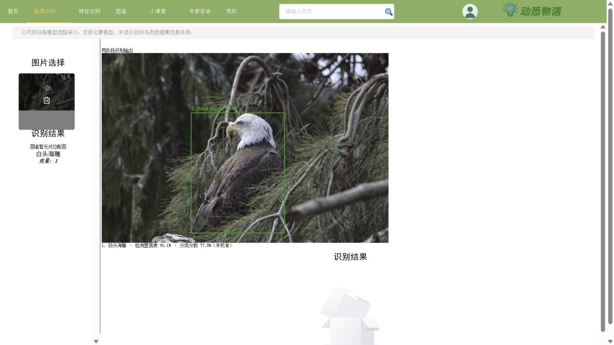
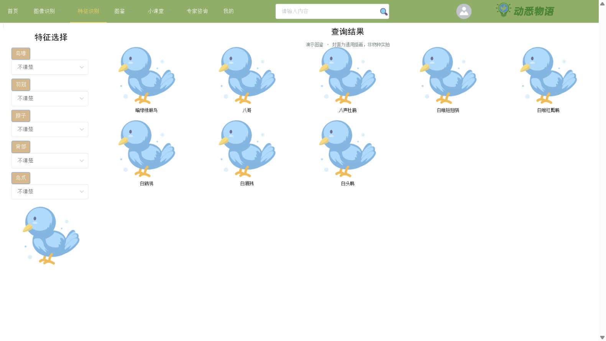
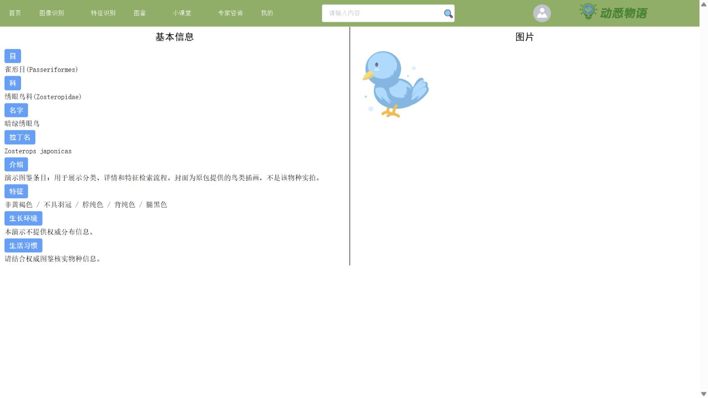
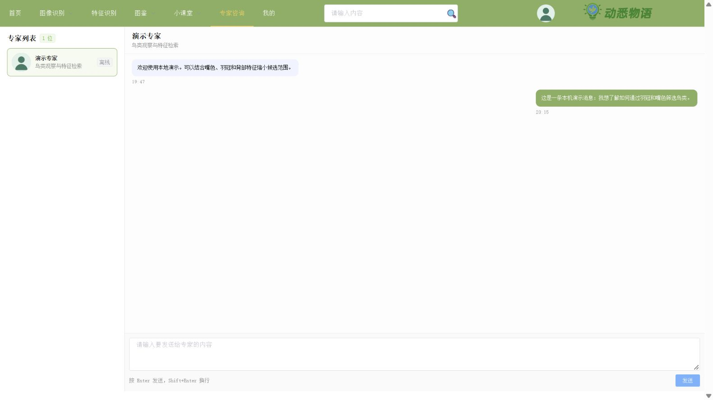

# 动悉物语 · 动植物图鉴与观察交流

从本地 `bird.zip` 归档恢复的 Vue 2 + Spring Boot 项目。支持分类图鉴、鸟类特征检索、综合搜索、登录和基于 WebSocket/STOMP 的专家聊天。

**当前可运行范围：本地图鉴、检索、账号和聊天；新增可选本地 YOLOv8＋EfficientNetV2 两阶段识别，已用公开预训练模型和真实图片验证到网页上传结果。原比赛算法权重没有恢复，尚未完成目标鸟类数据集的效果评测。未配置模型时仍明确返回“服务未配置”。**

## 新增本地两阶段识别 v0.2.0

`bird_service/` 提供 YOLOv8 检测 → OpenCV 裁剪 → EfficientNetV2-S 分类、训练评测 CLI 与 FastAPI 服务；Java 后端和 Vue 识别页已接入，不需要七牛云或外部鸟类服务。安装、公开预训练演示、自有类别训练及配置见 [算法模块 README](bird_service/README.md)。



本轮是新增重建实现。公开演示使用 COCO / ImageNet 预训练权重，只识别模型支持的类别；不等于原比赛模型恢复，也没有声称达到原比赛效果。

## 功能截图

### 按鸟喙、羽冠、脖子、背部和鸟爪筛选候选



### 图鉴详情与分类信息



### 专家聊天、实时消息与历史记录



截图来自实际本机运行。账号、专家和聊天内容均为演示数据；演示图鉴使用原包提供的通用插画作为鸟类封面，**不是对应物种实拍**。演示专家为虚构角色，不是真人在线咨询或自动 AI 回复。

## 技术与目录

- `frontend/`：Vue 2.7、Vue Router、Vuex、Element UI、Axios、SockJS、STOMP。
- `backend/`：Spring Boot 3.1.5、MyBatis、MySQL、Redis、JWT、Spring WebSocket。
- `database/demo.sql`：归档中的基础表结构，加上补齐的聊天表、综合检索视图和精选演示数据。
- `scripts/smoke_test.py`：12 组实际接口及 WebSocket 集成检查。
- 原代码保留 RabbitMQ、七牛云、外部鸟类/植物识别服务的集成逻辑；本地演示无需这些外部账号，相关云功能默认关闭。

## 本地运行

已验证：Windows、JDK 21、Maven 3.9.13、Node 20.19、MySQL 8、独立 Redis。Java 源码目标为 17。

1. 新建空数据库 `nature_atlas_demo`，字符集 `utf8mb4`；创建仅能访问该库的用户，导入 `database/demo.sql`。脚本仅适用于新的演示库，不要导入原业务库。
2. 启动专用 Redis：`redis-server --bind 127.0.0.1 --port 16381 --save ""`。
3. 设置当前终端的环境变量并启动后端：

```powershell
$env:DB_USER = '你的演示库用户'
$env:DB_PASSWORD = '你的演示库密码'
$env:DB_NAME = 'nature_atlas_demo'
$env:JWT_SECRET = [guid]::NewGuid().ToString('N') + [guid]::NewGuid().ToString('N')
cd backend
mvn -DskipTests package
java -jar target/bird.jar
```

4. 另开终端启动前端：

```powershell
cd frontend
npm ci --ignore-scripts --no-audit --no-fund
npm run serve
```

访问 **http://127.0.0.1:18901**，后端为 **http://127.0.0.1:18900**。前端 `/api` 与 `/ws-chat` 已代理到本机后端。

- 普通账号：`demo` / `Demo123456`
- 专家角色演示账号：`expert_demo` / `Demo123456`

登录另一账号时会替换浏览器当前会话；聊天页选择“演示专家”后可以发送消息并刷新查看历史。专家不在线时消息仍可保存，不会生成自动回复。

可选环境变量：`DB_HOST`、`DB_PORT`、`SERVER_PORT`、`REDIS_HOST`、`REDIS_PORT`、`UPLOAD_PATH`。默认仅监听本机回环地址。

## 真实识别与云服务

原图像识别链路依赖外部鸟类接口、百度植物识别、七牛云上传和 RabbitMQ。仅使用自己的服务与凭据配置：`BIRD_API_URL`、`BAIDU_API_KEY`、`BAIDU_SECRET_KEY`、`QINIU_ACCESS_KEY`、`QINIU_SECRET_KEY`、`QINIU_BUCKET`、`QINIU_DOMAIN`、`RABBITMQ_HOST`、`RABBITMQ_PORT`、`RABBITMQ_USER`、`RABBITMQ_PASSWORD`。

云调用开关为 `CLOUD_DETECTION_ENABLED=true` / `CLOUD_UPLOAD_ENABLED=true`。这些开关只启用原调用链，**不保证外部 API 现有响应格式兼容**。原外部模型、云头像上传及 RabbitMQ 上传队列尚未进行端到端验证。本次没有调用归档中原有的云密钥，也没有将这些密钥上传。本地两阶段识别使用独立的 `BIRD_LOCAL_ENABLED=true` 开关，已验证范围见新增算法模块。

## 验证

在专用演示数据库、Redis 和后端运行时执行：

```powershell
python -m pip install -r scripts/requirements.txt
python scripts/smoke_test.py
```

已通过的 12 组检查包括：鸟类分类树、特征条件过滤与参数化查询、图鉴详情、跨类别搜索、猫犬爬行及两栖图鉴、错误登录拒绝、JWT 登录且不返回密码摘要、账号资料及历史记录权限、未配置识别服务的明确失败响应、专家与会话历史、STOMP 实时消息及数据库持久化、再次登录后旧会话失效。

测试只用于可丢弃的演示库，会发送带“演示回归”前缀的聊天消息并更新演示账号昵称。前端生产构建为 `npm run build`，后端构建为 `mvn -DskipTests package`。GitHub Actions 使用独立 MySQL/Redis 执行构建和同一组集成检查。

## 本次恢复内容

- 整理前后端、修复 Vue 与编译器版本冲突，提交依赖锁文件。
- 移除硬编码远端地址、数据库密码及云密钥；环境变量配置本机服务，避免依赖原部署。
- 原备份缺少 `expert_info`、`expert_message` 和 `combined_tujian`，依据映射补齐表与视图。
- 修复专家接口多余空格与路由前缀、STOMP 私信目的地和身份传递不匹配。
- 保护个人资料修改与识别历史访问；校验 Redis 当前会话，阻止使用旧 token。
- 修复图片列表回退逻辑、删除 SQL 语法、空特征参数及部分前端错误响应处理。
- 去掉原账号、识别历史和完整数据库备份，改用精选图鉴样例与虚构账号。

## 来源与边界

代码及原有静态素材来自用户提供的项目归档，保留原目录对应关系和代码注释。本仓库是归档恢复与演示整理，不声称全部代码或素材为维护者原创。原包没有独立许可证文件，本次不替原作者追加开源许可授权；第三方依赖和素材权利仍归各自权利人。

旧版账号密码摘要方案沿用归档兼容逻辑，依赖也较旧；仅适合本机学习与展示，未做完整生产安全审计。完整生物数据库、音频、科普文章/视频内容及原外部识别服务不在本次验证范围内；新增本地识别的限制另见算法模块说明。
