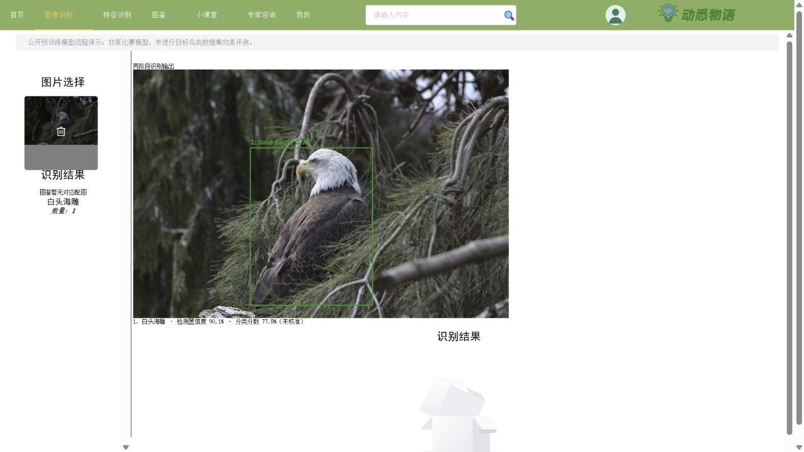

# YOLOv8 + EfficientNetV2 两阶段鸟类识别

YOLOv8 输出鸟类检测框，OpenCV 对目标做边界裁剪与 5% 外扩，EfficientNetV2-S 对每个区域分类，返回框、类别、分数、候选框数量和标注图。支持 CLI、FastAPI，以及现有 Spring Boot / Vue 页面。

**原项目归档没有识别模型代码或权重。本模块于 2026-11-01 新增，是算法重建实现，不是找回的原比赛模型。**

## v0.3.0 真实数据实验

已在完整 CUB-200-2011（200 类）训练并发布专用权重，GT 裁剪测试 Top-1 **78.65%**、macro-F1 **0.7857**；完整两阶段联合成功率 **72.75%**，不是 mAP。官方测试集 5,794 张未参与训练或选模。冻结主干对照 Top-1 为 **63.57%**。

[实验协议、复现命令与完整结果](docs/CUB200_EXPERIMENT.md) · [v0.3.0 权重下载](https://github.com/DiVincenzo11/nature-atlas/releases/tag/v0.3.0)。ImageNet 预训练可能与 CUB 测试图片重叠，不声称相对预训练集完全独立。下文默认 `fetch-models` 命令仍用于 ImageNet 流程演示，CUB 推理需显式指定下载的分类权重。

## 模型模式

- `imagenet_demo`：上游 COCO 预训练 YOLOv8n + TorchVision ImageNet-1K 预训练 EfficientNetV2-S。仅验证真实图片上的两阶段流程，没有训练新的鸟类专用模型。ImageNet 包含 59 个鸟类相关类别，部分是宽类别而非严格物种，无法覆盖图鉴全部鸟种。
- `custom_species`：本模块训练命令产生的专用分类器。类别和效果需由自己的数据及独立测试报告确定。没有权重时拒绝启动，不静默使用随机模型。

演示在完整 1000 类上做 softmax，最高类别属于鸟类集合且分数至少 0.2 才输出支持类别，否则保留未知；不在鸟类子集中重新归一化来抬高分数。阈值拒识只是启发式，**不是经校准的开放集识别**。检测置信度与分类分数分别展示，不相乘充当物种概率。

## 安装与运行

以下安装与 CLI 命令在 `bird_service/` 中执行。建议 Python 3.11/3.12：

```shell
python -m venv .venv
```

激活环境后，CPU 安装示例：

```shell
python -m pip install torch torchvision --index-url https://download.pytorch.org/whl/cpu
python -m pip install -e ".[test]"
python -m pytest -q
nature-birds fetch-models --out models
nature-birds predict --image examples/bald-eagle.jpg --out runs/eagle
nature-birds predict --image examples/flamingos.jpg --out runs/flamingos
nature-birds serve --port 18902
```

Windows 未激活时使用 `.venv\Scripts\python.exe`、`.venv\Scripts\nature-birds.exe`；Linux/macOS 使用 `.venv/bin/`。GPU 请按 [PyTorch 官方安装说明](https://pytorch.org/get-started/locally/) 选择版本。

下载来源：[Ultralytics 官方 YOLOv8](https://docs.ultralytics.com/models/yolov8/)、[TorchVision EfficientNetV2-S](https://docs.pytorch.org/vision/stable/models/generated/torchvision.models.efficientnet_v2_s.html)。下载命令显式联网并记录 SHA-256，服务启动不下载模型。仅加载可信权重。

服务仅监听 `127.0.0.1`：`GET /health`；`POST /predict` 接收 multipart 字段 `file`。默认 CPU、640 检测输入、阈值 0.25、最多 20 框，图片最多 8MB / 2500 万像素。推理串行执行，未做并发生产验收。

```shell
curl -F "file=@examples/bald-eagle.jpg" http://127.0.0.1:18902/predict
```

返回 `detections`、`info`（各类别候选框数量）、`image`（JPEG data URL）、`model` 和 `status`。未检测到鸟时返回空列表，不补造分类。重复框、漏检与分类错误仍可能出现，候选框数不等于人工确认的真实鸟数。

## 接入动悉物语

保持模型服务运行。按根 README 设置数据库、JWT 和 Redis；在**启动 Java 后端的同一终端**增加：

```powershell
$env:BIRD_LOCAL_ENABLED = 'true'
$env:BIRD_LOCAL_API_URL = 'http://127.0.0.1:18902/predict'
```

然后在仓库根目录的 `backend/` 运行 `mvn -DskipTests package`、`java -jar target/bird.jar`；另开终端在 `frontend/` 运行 `npm run serve`。登录后进入 `/scan/birdscan` 上传图片。

本地模式调用新增 `LocalBirdRecognitionService`，无需七牛云、RabbitMQ 或外部鸟类 API，保留现有认证、userid 归属检查与限流。日志只存类别，不将 base64 图片写入历史 URL 字段，因此历史列表没有本地云端缩略图。

模型类别未匹配图鉴时，仍展示检测图与分数，不编造百科与物种配图。



## 自有鸟类数据训练与评测

JSONL manifest 的路径相对于文件所在目录，每行至少包含文件、类别、来源组和划分；可选 `box` 是像素 xyxy 框：

```json
{"file":"images/train001.jpg","label":"species_a","group":"source_photo_001","split":"train","box":[30,40,260,300]}
```

至少两个类别、非空 train/val；正式报告还需独立 test。同一原图的变换、连拍和视频应使用相同 group。跨划分共享 group 或完全相同像素会报错；近重复和相同个体仍需人工正确分组。

```shell
nature-birds train --manifest data/birds/manifest.jsonl --out runs/species-v1 --epochs 20 --batch 4 --device cpu
nature-birds evaluate --checkpoint runs/species-v1/best.pt --manifest data/birds/manifest.jsonl --split test --out runs/species-v1/test.json
nature-birds serve --classifier runs/species-v1/best.pt
```

默认 ImageNet 初始化、224 分类输入、AdamW 1e-3、随机裁剪/翻转，按验证集 macro-F1 选权重，测试数据不参与训练与选模。报告 accuracy、macro-F1、逐类 F1 与混淆矩阵，**评测的是提供裁剪区域的分类效果，不是整条检测链的 mAP**。

无框数据需先离线检测并人工检查裁剪，或直接提供鸟类裁剪图。自训练检测器可按 Ultralytics YOLOv8 格式另行训练，保留英文 `bird` 类别名，再用 `--detector` 加载。它不自动恢复原项目的数据、参数与标注协议。

软件诊断：`python scripts/verify_training.py --out runs/software-diagnostic`。使用标记 SYNTHETIC 的非鸟类几何图，检查一轮训练、保存加载与评测。不能作为鸟类识别准确率。

## 历史公开预训练演示与边界

v0.2.0 在 Windows CPU 下 8 项测试通过；实际 Python API → Java 接口 → Vue 上传成功。白头海雕图返回 1 个框、bald eagle；红鹳群体图返回 13 个候选框，其中 11 个 flamingo、2 个 unknown；空白图返回零框。没有逐框人工标注，**不计算准确率、召回率或物种计数精度**。

原图来源与许可见 `examples/SOURCES.json`；结果和诊断记录见 `artifacts/`。图片来自 Smithsonian 公共领域资源，不声称与预训练数据完全独立。该历史演示没有目标鸟类训练集，也没有恢复原比赛性能；v0.3.0 的 CUB 训练与新权重接口检查另见上方实验报告。当前算法测试共 13 项通过。

本模块新增 Python 代码按 AGPL-3.0 提供，见 `LICENSE`。它不改变原仓库归档代码与素材的权利状态。上游依赖、权重及照片各自遵循其许可。
