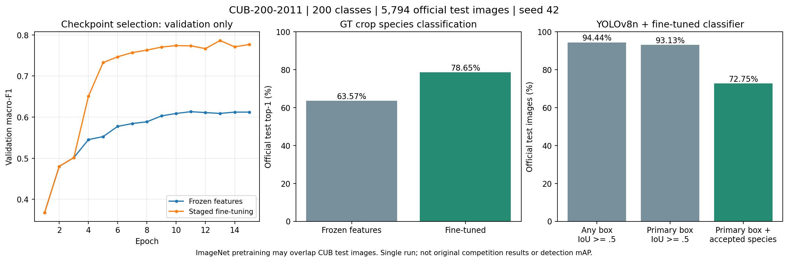

# CUB-200-2011 真实鸟类实验 · v0.3.0

本版在完整 CUB-200-2011 上新训练 EfficientNetV2-S，并接入现有 YOLOv8n 检测、OpenCV 裁剪、FastAPI、Java 和 Vue。**不是找回的原比赛模型，也不是原比赛指标复现。**

## 数据与划分

来源为 [Caltech 官方数据页](https://www.vision.caltech.edu/datasets/cub_200_2011/) 与 [官方数据存档](https://data.caltech.edu/records/65de6-vp158)。完整 200 类、11,788 张照片；官方测试集 5,794 张保持不变。官方训练集 5,994 张中，每类抽取 6 张验证图（Python `random.Random(42 + class_id)`），得到训练 4,794、验证 1,200、测试 5,794。

数据集官方说明提醒 **CUB 测试图可能与 ImageNet 预训练图重叠**。因此不能把“未使用测试标签训练/选模”等同于“相对所有预训练数据完全独立”，也不与从零训练或不同预训练协议的论文数字直接比较。

按解码后的 RGB 像素哈希检查，跨划分完全相同图片为 0；group 是官方原图 ID，未建立个体、摄影者或近重复分组。30 个官方框略超出图片边界，按图像边界截断，逐项记录在 `split-audit.json`；没有删图。EXIF 方向、官方注释数量及路径均在准备阶段校验。

数据仅用于非商业研究与教育，照片版权仍属各权利人。仓库提供下载脚本、ID/标签/划分、哈希和统计；**不随源码包或 Release 再分发 CUB 原图或含原图的网页截图**。

## 训练协议

两组均使用 TorchVision EfficientNetV2-S ImageNet-1K V1 初始化，224×224 分类输入，先按 GT 框外扩 5% 裁剪。训练随机裁剪（scale 0.8–1.0）及水平翻转；验证与测试等比缩放、中心裁剪；ImageNet mean/std。

- 固定种子 42，每组 15 epoch，batch 32；AdamW，weight decay 1e-4，cosine schedule，最低学习率 1e-6。
- 分类头学习率 1e-3；全网微调组先冻结主干与其 BN 3 epoch，再以 5e-5 学习率解冻主干。
- 冻结基线始终只训练分类头，主干及其 BN 保持冻结。相同 epoch 数并不代表相同计算预算。
- CUDA AMP 训练，FP32 验证/测试，4 个 DataLoader worker；仅按验证集 macro-F1 保存最佳权重。测试标签不参与选模、阈值调整或训练。
- Windows / Python 3.12 / torch 2.7.1+cu128 / torchvision 0.22.1+cu128 / RTX 5070 Ti Laptop 12GB。完整环境见 `requirements-cub200-tested.txt`。一次固定预算实验，未做多种子或超参搜索。

本次原始检查点将 PyTorch 版本存成了 `TorchVersion` 对象，训练结束后的默认安全加载拒绝该元数据。已修正后续保存逻辑，并使用 `export-classifier` 将本次原始检查点的版本元数据转为普通字符串；**所有训练张量逐项 bitwise 相等**，导出文件通过默认 `weights_only=True` 加载。训练没有重跑，选模没有改变；两组完成训练后才从导出权重执行测试。原始训练日志、实际训练源文件快照及导出前后 SHA-256 均保留在实验附件中。

## 实测结果

全部分类结果基于 5,794 张官方测试图的 **GT 裁剪区域**：

- 冻结主干基线：Top-1 **63.57%**，Top-5 **89.49%**，macro-F1 **0.6337**。
- 分阶段全网微调：Top-1 **78.65%**，Top-5 **94.79%**，macro-F1 **0.7857**。
- Top-1 增加 **15.08 个百分点**，macro-F1 增加 **0.1520**。单次实验差值，不代表统计显著性结论。



整图两阶段另测相同 5,794 张：上游 COCO YOLOv8n 未重训，检测输入 640、置信度 0.25、最多 20 框；分类阈值固定 0.2。主框只按检测置信度最高选择，不看 GT 选框。

- 任一框命中标注主体（IoU≥0.5）：**5,472 / 5,794 = 94.44%**。
- 主框命中标注主体：**5,396 / 5,794 = 93.13%**。
- 在主框命中的图片上，原始 Top-1 物种分类正确：**4,218 / 5,396 = 78.17%**。
- 同时主框命中、鸟种正确且分类分数通过默认阈值：**4,215 / 5,794 = 72.75%**。

以上是单个标注主体的召回与联合成功率，**不是 detection mAP**。CUB 每图只标注一个主体，其余鸟可能未标注，不能据此将所有多余框当作真实误检。主框种类正确但未命中 GT 的图片不计联合成功。类别概率未校准，阈值拒识不代表经过验证的开放集能力。

`artifacts/cub200-v0.3.0/` 包含完整混淆矩阵、逐图预测、训练曲线、配置、选模记录、ID/划分及哈希，支持核对失败案例。未清除失败预测或只报告成功样例。

## 从零运行同一协议

在 `bird_service/` 下执行。先按 PyTorch 官方说明安装适配显卡的 torch/torchvision，再安装本模块：

```shell
python -m pip install -e ".[test,experiment]"
python -m pytest -q
nature-birds fetch-models --out models
python scripts/download_cub.py --out data/cub200
python scripts/prepare_cub.py --root data/cub200 --seed 42 --validation-per-class 6
python scripts/run_cub_experiment.py --dataset-root data/cub200 --init-imagenet models/efficientnet_v2_s_imagenet.pt --out runs/cub200 --epochs 15 --batch 32 --workers 4 --device cuda:0
python scripts/evaluate_cub.py --dataset-root data/cub200 --experiment runs/cub200 --detector models/yolov8n.pt --out runs/cub200-release --device cuda:0 --batch 32 --workers 4
```

最后一步对两组已选权重作兼容性导出、再次评测，并运行全量整图两阶段评测。训练控制器也会在两组训练都完成后生成分类测试报告；同一已选权重的重复评测不会用于调参。输出目录需不存在，脚本拒绝覆盖既有实验。下载需约 1.15GB，原图、环境和运行输出留在被忽略的目录。GPU 硬件和依赖变化可能导致数值差异，不保证跨设备逐 bit 重现。

## 加载已发布权重并接入网页

从 [v0.3.0 Release](https://github.com/DiVincenzo11/nature-atlas/releases/tag/v0.3.0) 下载 `cub200-finetuned-efficientnetv2-s.pt`，按 SHA256SUMS 校验，存入 `models/`：

```shell
nature-birds serve --detector models/yolov8n.pt --classifier models/cub200-finetuned-efficientnetv2-s.pt --device cpu --port 18902
```

Java 后端仍按算法 README 设置 `BIRD_LOCAL_ENABLED=true`、本地模型 URL、数据库/JWT/Redis，再启动 Vue。无需重新训练即可推理；`fetch-models` 仅下载上游演示初始化，**不会自动切换到 CUB 权重**。CUB 包含 200 个官方类别，不保证覆盖原图鉴中的中国鸟类；页面无对应图鉴时照常显示模型英文类名及检测图。

本次使用发布权重在 CPU 环境安全加载，并通过真实 Python API → 已认证 Java 上传 → Vue 页面：第一张官方测试图 ID 1 返回 Black footed Albatross。固定前三张官方测试图、白图零框、无效图片 HTTP 400 的接口记录见 `integration.json`，仅证明服务联通，不作为准确率样本。检测库替换 Pillow 解码器导致无效图片落入缺少 HEIF 插件的分支，已通过保留原始解码器修复并增加回归测试。

```shell
python scripts/verify_local_cub.py --manifest data/cub200/manifest.jsonl --out runs/integration.json
```

复现接口检查使用可丢弃的 `demo` 账号与演示库，遵循既有 3 秒识别限流；会新增识别历史。网页截图仅留在本地，统计图不含数据集照片。

## 模型用途与后续工作

适合展示公开数据下的两阶段工程、训练对照、独立选模与错误分析。权重基于受限用途的研究数据训练，本版只供非商业研究/教育使用，不能自动取得训练照片的再分发权。新增 Python 源码许可与数据、上游模型和原归档素材的权利分别适用。

尚未完成：原比赛数据/权重恢复、YOLO 专用检测器训练、多种子、原图鉴类别覆盖、域外/非鸟类系统评测、概率校准、生产部署安全与并发验收。不能以本版指标替代原比赛、论文或实际部署效果。
